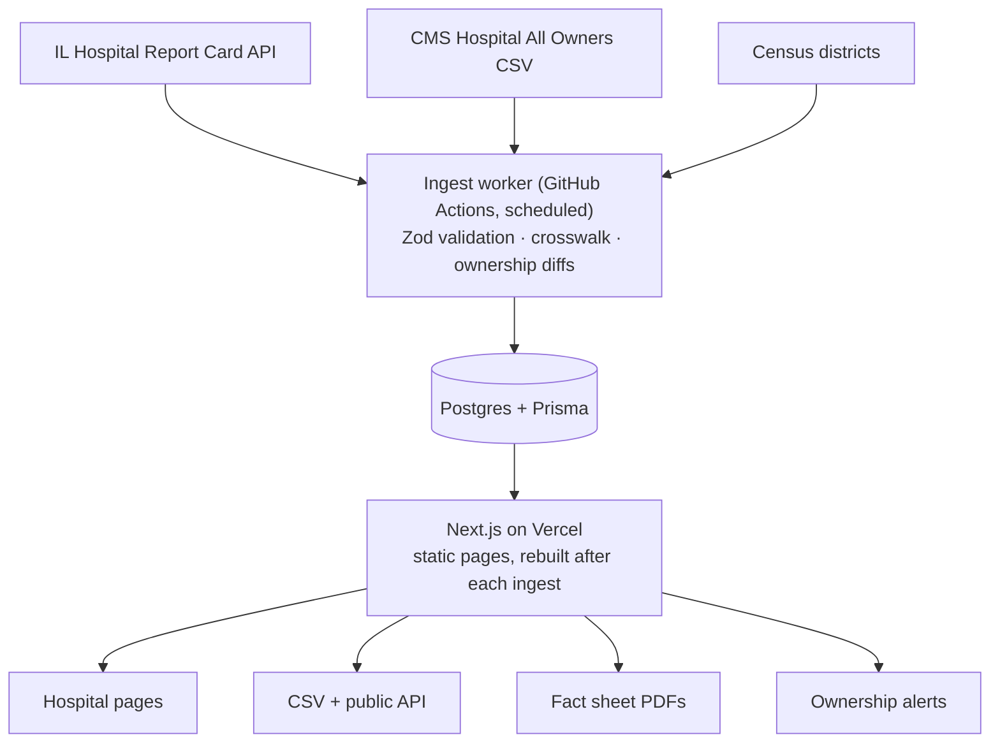

<div align="center">

# OpenStaffing

**Is this hospital short-staffed, and who profits from it?**

Free, open-source data on how well hospitals staff their nurses, and who owns them.
Every number links to its public source.

[](LICENSE)


</div>

---

## Why this exists

The United States doesn't so much have a shortage of nurses as a shortage of nurses willing to work
under current hospital conditions. Burnout from chronic understaffing is pushing experienced
nurses away from the bedside, and a growing share of hospitals are owned by private equity firms
under pressure to cut costs.

Illinois already makes every hospital report unit-level nurse staffing to the state, and federal
data now flags private equity and real estate investment trust (REIT) owners of every Medicare
hospital. But the two have never been joined into one tool that a nurse, an organizer, a reporter,
or a legislator can use in under a minute.

OpenStaffing does that, and stays strictly neutral: the data makes the case, the site does not.

## Who it's for

| Audience                  | What they get                                                               |
| ------------------------- | --------------------------------------------------------------------------- |
| Nurses and unions         | Side-by-side staffing comparisons for bargaining, testimony, and complaints |
| Legislators and staff     | Every hospital in a district, with its staffing and ownership, on one page  |
| Reporters and researchers | Clean, sourced, downloadable data with a public methodology                 |
| Patients and the public   | A plain-language profile of their local hospital                            |

## What it does

- [ ] **Hospital profiles:** staffing by unit (med-surg, critical care, mother-baby, NICU) with trends, peer comparison, and the full ownership chain
- [ ] **Compare view:** two to five hospitals side by side, shareable by URL
- [ ] **Rankings and map:** sort and filter every hospital by any staffing measure, owner type, or region
- [ ] **Health system view:** all hospitals under one owner, to see whether problems are chain-wide
- [ ] **Ownership watch:** monthly alerts when a hospital's owners change, including new private equity or REIT owners
- [ ] **District lookup and fact sheets:** printable one-pagers for legislator meetings
- [ ] **Open data:** CSV downloads, monthly snapshots, and a public read-only API
- [ ] **More states:** a national ownership tracker first, then staffing data one state at a time

Track progress in the [roadmap](docs/roadmap.md).

## Data sources

| Source                                                                                                                                 | What it provides                                                                                      | Refresh                        |
| -------------------------------------------------------------------------------------------------------------------------------------- | ----------------------------------------------------------------------------------------------------- | ------------------------------ |
| [Illinois Hospital Report Card](https://healthcarereportcard.illinois.gov) ([API](https://healthcarereportcard.illinois.gov/api/docs)) | Unit-level nurse staffing: RN hours per patient day, turnover, vacancy, contract nurse use, skill mix | Annual periods, checked weekly |
| [CMS Hospital All Owners](https://data.cms.gov/provider-characteristics/hospitals-and-other-facilities/hospital-all-owners)            | Every owner of every Medicare-enrolled hospital, with private equity and REIT flags                   | Monthly                        |
| [PESP Private Equity Hospital Tracker](https://pestakeholder.org/pesp-private-equity-hospital-tracker/)                                | Expert cross-check of private equity ownership (used with permission and credit)                      | About yearly                   |
| Census TIGER/Line and Geocoder                                                                                                         | State legislative districts for each hospital                                                         | As redistricting changes       |

Details, caveats, and licensing: [docs/data-sources.md](docs/data-sources.md).

## Architecture



The ingest worker is the only part that talks to the outside world. The site only reads from the
database, so a broken upstream API never breaks the site. More in
[docs/architecture.md](docs/architecture.md).

## Repository layout

```
openstaffing/
├── apps/
│   └── web/                 Next.js site (App Router)
├── packages/
│   ├── core/                Shared types, measure vocabulary, stats, name normalization
│   ├── db/                  Prisma schema, client, and local seed
│   └── ingest/              Data importers and CLI (Report Card, CMS owners)
├── docs/                    Architecture, data sources, methodology, roadmap, ADRs
├── .github/                 CI, scheduled ingest, issue and PR templates
└── docker-compose.yml       Local Postgres with PostGIS and pg_trgm
```

## Quickstart (about 5 minutes)

**You need:** Node.js 22.12+ (or 24+), npm 10+ (included with Node), and Docker.

```bash
git clone https://github.com/oliviadavis593/OpenStaffing.git
cd OpenStaffing
cp .env.example .env
npm install
npm run db:up                       # start local Postgres (PostGIS + pg_trgm)
npm run db:migrate -- --name init   # create tables (first run only)
npm run db:seed                     # load 3 fictional sample hospitals
npm run dev                         # http://localhost:3000
```

The seed data is clearly labeled as fictional. To load real data, see
[Loading real data](#loading-real-data).

## Common commands

| Command                             | What it does                                      |
| ----------------------------------- | ------------------------------------------------- |
| `npm run dev`                       | Run the site locally                              |
| `npm run build`                     | Production build of every package                 |
| `npm run typecheck`                 | TypeScript checks across the monorepo             |
| `npm test`                          | Unit tests (Vitest)                               |
| `npm run lint` / `npm run format`   | ESLint and Prettier                               |
| `npm run db:up` / `npm run db:down` | Start or stop local Postgres                      |
| `npm run db:migrate`                | Create and apply a migration from `schema.prisma` |
| `npm run db:studio`                 | Browse the database in Prisma Studio              |
| `npm run ingest -- help`            | List data import commands                         |

## Loading real data

```bash
# 1. Find the Report Card's staffing measure IDs (no database needed)
npm run ingest -- il:measures:discover "Nursing Hours"
npm run ingest -- il:measures:discover "Turnover"

# 2. Map the right IDs in packages/ingest/src/sources/il-report-card/staffing-measures.ts

# 3. Import hospitals, then staffing values
npm run ingest -- il:hospitals
npm run ingest -- il:values

# 4. Inspect a downloaded CMS ownership file
npm run ingest -- cms:owners:inspect ./data/raw/hospital_all_owners.csv
```

Every run is recorded in the `IngestRun` table, which powers the site's data freshness indicator.
Suspicious values (zeros, missing units, swings over 50%) are flagged and shown with a caveat,
never silently hidden.

## Principles

1. **Every number shows its source,** measure name, and reporting period.
2. **Neutral presentation.** The data persuades; the site does not editorialize or assign grades.
3. **No patient data, ever.** Public data only. Anything nurse-reported lives in a separate,
   union-controlled tool under their rules.
4. **No tracking.** No cookies, no ad scripts, privacy-friendly analytics only.
5. **Accessible by default.** WCAG 2.1 AA, a table alternative for every chart, and pages that
   work on a phone, in a hearing room, and on paper.

## Contributing

Contributions are welcome from engineers, designers, data people, nurses, and organizers. Start
with [CONTRIBUTING.md](CONTRIBUTING.md), then look for issues labeled `good first issue`.

Chicago folks: we work on this at [Chi Hack Night](https://chihacknight.org). Come say hi.

Want to bring OpenStaffing to your state? Read [docs/adding-a-state.md](docs/adding-a-state.md).

## Using the data

OpenStaffing republishes public data. Please credit the original sources (listed on every page
and in [docs/data-sources.md](docs/data-sources.md)) and link to OpenStaffing where you can. Spot
an error? [Report it](../../issues/new?template=data_error.md) and it will be checked and
corrected in public.

## License

Code is released under the [MIT License](LICENSE). Republished data remains subject to the terms
of its original publishers.

## Acknowledgments

Built with and for the nurses who keep hospitals running. Thanks to the Illinois Department of
Public Health and CMS for publishing this data, the Private Equity Stakeholder Project for its
hospital tracker, and the Chi Hack Night community.
