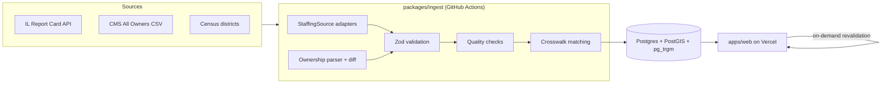

# Architecture

OpenStaffing is a TypeScript monorepo: a scheduled ingest pipeline fills Postgres, and a mostly
static Next.js site reads from it.

## Packages

| Package                | Responsibilities                                                                      | Depends on |
| ---------------------- | ------------------------------------------------------------------------------------- | ---------- |
| `@openstaffing/core`   | Measure vocabulary, units, stats (median, percentile), name normalization, formatting | nothing    |
| `@openstaffing/db`     | Prisma schema, shared client, local seed                                              | core       |
| `@openstaffing/ingest` | HTTP with rate limiting and retries, source adapters, CMS parser, quality checks, CLI | core, db   |
| `@openstaffing/web`    | Pages, `Figure` component, revalidation endpoint                                      | core, db   |

Workspace packages ship TypeScript source. Next.js compiles them through `transpilePackages`, and
the CLI runs through `tsx`, so there is no build step between packages.

## Data flow

1. **Hospitals.** CMS ownership ingest creates a `Hospital` row (keyed by CCN) for every Medicare
   hospital in every state. State staffing sources attach their own IDs
   (`reportCardEntityId` for Illinois) through the crosswalk.
2. **Measures and values.** Each `StaffingSource` adapter lists its measures and values. Values
   upsert on `(hospital, measure, periodStart, periodEnd)`, so re-running ingest is safe.
3. **Quality flags.** Zeros, missing units, and changes over 50% from the previous period create
   `QualityFlag` rows. Flagged values are still shown, with a caveat.
4. **Ownership.** Each monthly CMS snapshot becomes `Ownership` rows tagged with `snapshotMonth`.
   Consecutive snapshots are diffed into `OwnershipChange` rows that power alerts.
5. **Crosswalk.** Names and addresses are normalized (`packages/core/src/normalize.ts`), scored
   with `pg_trgm` similarity, auto-accepted above a threshold, and otherwise queued in
   `CrosswalkMatch` for human review. Review decisions survive re-ingest.
6. **Publishing.** After a successful ingest, the workflow calls `/api/revalidate`, and Next.js
   rebuilds affected pages.

## Key design decisions

- [ADR 0001: Stack and hosting](adr/0001-stack.md)
- [ADR 0002: Staffing source adapters and cross-state comparability](adr/0002-staffing-source-adapters.md)

## Data model

See `packages/db/prisma/schema.prisma`; every model has a doc comment. Core tables: `Hospital`,
`HealthSystem`, `Measure`, `MeasureValue`, `QualityFlag`, `Owner`, `Ownership`,
`OwnershipChange`, `CrosswalkMatch`, `IngestRun`.
